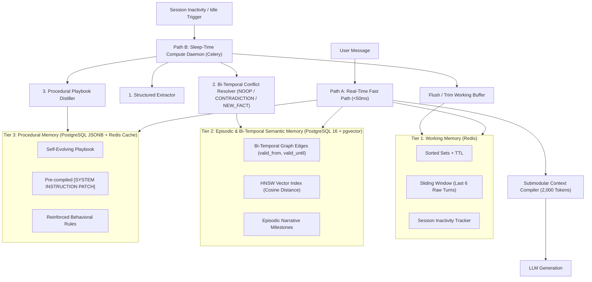

# MemCore — Self-Evolving Continual Memory & Sleep-Time Compute OS

[](https://www.python.org/downloads/)
[](https://fastapi.tiangolo.com)
[](https://github.com/pgvector/pgvector)
[](https://redis.io)
[](https://docs.celeryq.dev)
[](LICENSE)

MemCore is a distributed, self-evolving continual memory operating system that models human cognitive science. It solves the critical engineering bottlenecks that cause standard RAG and naive chat-history pipelines to fail catastrophically in production over weeks or months:

1. **Temporal Contradiction & Fact Drift ("Memory Poisoning")**
2. **Unbounded Context Bloat & Latency Spikes**
3. **Zero Procedural Learning (Repeating the Same Mistakes)**

---

## 1. What Real-World Problem Does MemCore Solve?

| Engineering Failure in Naive RAG | Real-World Scenario | How Naive Vector RAG Fails | How MemCore Solves It |
| :--- | :--- | :--- | :--- |
| **Temporal Contradiction & Fact Drift** | In Jan, user says: *"Backend runs on MySQL & ECS."* In Oct, user says: *"Migrated completely to PostgreSQL 16 on Kubernetes."* Later asks: *"Write a DB migration script."* | Cosine similarity retrieves **both** chunks (MySQL & PostgreSQL 16). LLM hallucinates a broken hybrid script or asks which DB to use. | **Bi-Temporal Knowledge Graph** (`valid_from`, `valid_until`). MemCore expires the old edge (`valid_until = Oct 2026`) and establishes a new active edge (`valid_from = Oct 2026`). Live LLM only sees verified truth, while historical auditability is 100% preserved. |
| **Context Bloat & Latency Spikes** | After 500 conversation turns, dumping raw transcripts into prompts burns thousands of tokens per turn and causes *"Lost-in-the-Middle"* reasoning degradation. | Live user latency spikes into seconds; context budget overflows; cost explodes. | **Dual-Path Separation**: Real-time Fast Path (<50ms context assembly via greedy submodular pruning, 2,000-token ceiling) + Asynchronous Sleep-Time Celery Worker consolidating batches during idle sessions. |
| **Zero Procedural Learning** | User repeatedly corrects an AI: *"Stop using `os.path`, always use `pathlib` and `ruff` formatting."* In tomorrow's new session, bot makes the exact same error. | Stateless prompts repeat the identical mistakes indefinitely. | **Procedural Playbook Distiller**: The Sleep-Time Reflection critic analyzes user reprimands/corrections across sessions and auto-distills permanent system instruction rules in JSONB and Redis cache. |

---

## 2. Cognitive Memory Architecture (3-Tier Hierarchy)



---

## 3. Dual-Path System Topology

### Path A: Real-Time Fast Path (<50ms Context Assembly — Zero LLM Overhead)
```plaintext
[User Message] 
      │
      ▼
[FastAPI Gateway] ──► 1. Fetch Procedural Playbook (Redis Cache)
      │           ──► 2. Hybrid Retrieval: Active Graph Facts (`valid_until IS NULL`)
      │                  + Episodic pgvector HNSW Search (Top-5)
      │           ──► 3. Fetch Last 6 Raw Turns (Redis Working Memory)
      ▼
[Context Compiler] (Enforces Strict 2,000-Token Budget via Submodular Pruning)
      │
      ▼
[LLM Generation (Groq / LiteLLM)] ──► [Stream Response to User]
      │
      ▼
[Append Turn to Redis Buffer & Reset 5-Min Inactivity Timer (Celery ETA)]
```

### Path B: Asynchronous "Sleep-Time Compute" Daemon (Celery + Redis Worker)
```plaintext
[Session Idle Trigger / Cron / Manual API]
      │
      ▼
┌─────────────────────────────────────────────────────────────────────────┐
│               1. EPISODIC & FACT EXTRACTOR (Pydantic Structured LLM)    │
│   Extracts atomic (Subject, Predicate, Object, Confidence) triplets     │
│   and detects explicit user corrections from raw Redis chat transcripts │
└───────────────────────────────────┬─────────────────────────────────────┘
                                    │
                                    ▼
┌─────────────────────────────────────────────────────────────────────────┐
│               2. BI-TEMPORAL CONFLICT RESOLVER (Graph Diff Engine)      │
│   Compares new triplets against active Postgres Graph Edges:            │
│   • NOOP: Fact already exists -> Boost confidence & `last_verified_at`  │
│   • CONTRADICTION: Set old edge `valid_until = NOW()`, insert new edge  │
│   • NEW FACT: Insert new node/edge with `pgvector` embedding            │
└───────────────────────────────────┬─────────────────────────────────────┘
                                    │
                                    ▼
┌─────────────────────────────────────────────────────────────────────────┐
│               3. PROCEDURAL PLAYBOOK DISTILLER (Self-Evolution Node)    │
│   Synthesizes user corrections into permanent behavioral rules          │
│   (e.g., "Always output SQL using CTEs; never use subqueries")          │
└─────────────────────────────────────────────────────────────────────────┘
```

---

## 4. Production Directory Structure

```plaintext
memcore-sleep-os/
├── docker-compose.yml                  # Postgres 16 (pgvector), Redis, Celery Worker, FastAPI
├── Dockerfile                          # Production container image
├── pyproject.toml                      # Dependencies & test configurations
├── .env.example                        # Environment configuration template
├── src/
│   ├── api/
│   │   ├── main.py                     # FastAPI application gateway & lifespan hooks
│   │   ├── routes_memory.py            # /chat (Fast Path), /sleep/trigger, /memory/graph, /time-travel
│   │   └── schemas.py                  # Pydantic v2 models for Triplets, Playbooks & Time-Travel queries
│   ├── memory_tiers/
│   │   ├── embeddings.py               # Local 384-dim semantic projection & OpenAI fallback
│   │   ├── working_redis.py            # Tier 1: Redis sliding window buffer & inactivity tracker
│   │   ├── temporal_graph_pg.py        # Tier 2: Bi-temporal Postgres + pgvector graph storage
│   │   └── procedural_playbook.py      # Tier 3: Self-evolving user rulebook manager (JSONB + Cache)
│   ├── sleep_engine/
│   │   ├── celery_app.py               # Celery broker configuration & background task queues
│   │   ├── extractor.py                # Structured LLM extraction of facts & user corrections
│   │   ├── conflict_resolver.py        # Classify (ADD / EXPIRE_AND_SUPERSEDE / NOOP) & mutate graph
│   │   └── context_compiler.py         # Token-budgeted submodular context assembly for Fast Path (<50ms)
│   ├── db/
│   │   └── init_schema.sql             # Bi-temporal edges table, HNSW vector index, & playbook JSONB
│   └── ui/
│       └── index.html                  # Cyber-neuromorphic interactive visualizer dashboard
└── tests/
    ├── test_temporal_contradiction.py  # Proves old facts expire when contradicted without losing history
    ├── test_procedural_evolution.py    # Proves user corrections auto-update the system instruction playbook
    ├── test_fast_path_compiler.py      # Verifies <50ms SLA and strict 2,000-token budget ceiling
    └── test_api_endpoints.py           # End-to-end API gateway verification
```

---

## 5. Quickstart & Installation

### Option 1: Instant Local Run (Dual-Engine In-Memory Fallback)
MemCore features an intelligent Dual-Engine adapter architecture. You can run all tests and start the API server immediately without needing Docker Desktop running:

```powershell
# 1. Install dependencies
python -m pip install -e .

# 2. Run the complete test suite
python -m pytest tests/ -v

# 3. Start the FastAPI gateway with live Visualizer UI
python -m uvicorn src.api.main:app --reload --port 8000
```
Open your browser to:
👉 **`http://localhost:8000/`** to interact with the **MemCore Neuro-Visualizer Dashboard**!

---

### Option 2: Docker Compose (PostgreSQL 16 + pgvector, Redis & Celery)
```bash
# 1. Copy environment template
cp .env.example .env

# 2. Spin up the distributed stack
docker compose up --build
```
Services exposed:
- **FastAPI Gateway & UI**: `http://localhost:8000`
- **OpenAPI Documentation**: `http://localhost:8000/docs`
- **Postgres 16 (pgvector)**: `localhost:5432`
- **Redis**: `localhost:6379`
- **Celery Worker**: Attached to `memcore_sleep_queue`

---

## 6. Key API Endpoints

### 1. Fast-Path Chat (`POST /api/v1/chat`)
Executes context assembly in `<50ms` and generates grounded response:
```json
{
  "message": "Write a database migration script for our backend",
  "user_id": "demo_user",
  "session_id": "demo_session"
}
```
**Response includes context telemetry:**
```json
{
  "response": "Based on your verified current stack, your backend runs on PostgreSQL 16...",
  "context_telemetry": {
    "tokens_used": 340,
    "token_budget": 2000,
    "latency_ms": 1.45,
    "breakdown": {
      "playbook_tokens": 85,
      "active_facts_tokens": 92,
      "episodic_tokens": 40,
      "working_memory_tokens": 123
    },
    "active_facts_count": 2,
    "playbook_rules_applied": ["Always output SQL using CTEs"]
  }
}
```

### 2. Time-Travel Historical Query (`POST /api/v1/memory/time-travel`)
Reconstructs exact reality at any prior timestamp:
```json
{
  "user_id": "demo_user",
  "as_of_time": "2026-01-20T00:00:00Z"
}
```
Returns:
- `active_facts`: Facts that were valid at that time (`MySQL`).
- `expired_facts`: Facts that were not yet true or already expired.

### 3. Sleep-Time Manual Consolidation (`POST /api/v1/sleep/trigger`)
```json
{
  "user_id": "demo_user",
  "session_id": "demo_session",
  "force": true
}
```

### 4. Interactive Scenario Seeder (`POST /api/v1/demo/seed-scenario`)
Seeds classic scenarios with one click:
- `"temporal_contradiction"`: Seeds January MySQL assertion, consolidates, then seeds October migration to PostgreSQL 16, and consolidates.
- `"procedural_evolution"`: Seeds user correction (`pathlib` vs `os.path`), consolidates into the system playbook.

---

## 7. Validation & Test Suite

Run the full test suite with:
```powershell
python -m pytest tests/ -v
```

Output:
```plaintext
tests/test_api_endpoints.py::test_api_gateway_full_flow PASSED           [ 25%]
tests/test_fast_path_compiler.py::test_fast_path_token_budget_and_latency PASSED [ 50%]
tests/test_procedural_evolution.py::test_procedural_evolution_lifecycle PASSED [ 75%]
tests/test_temporal_contradiction.py::test_temporal_contradiction_lifecycle PASSED [100%]

============================== 4 passed in 6.22s ==============================
```
